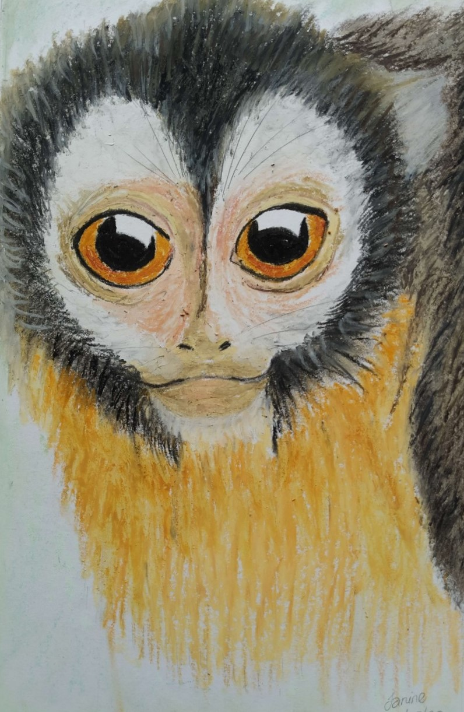
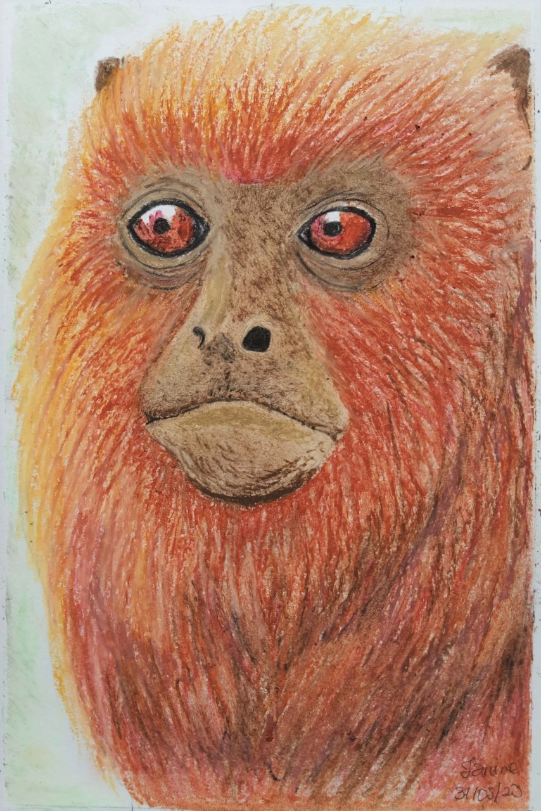
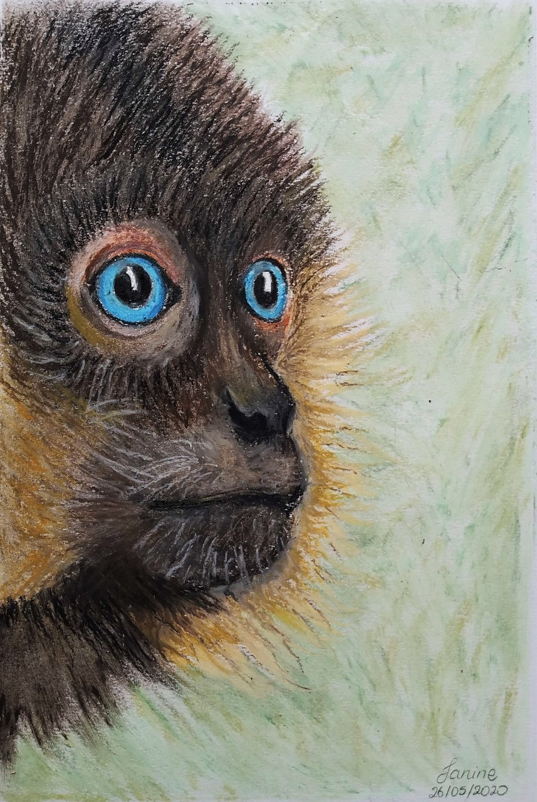

Soy ilustradora y científica. Uso la ilustración como puente entre la investigación y las personas: retratos de científicas, diseños inspirados en la vida microscópica y la naturaleza, y proyectos de divulgación principalmente gracias a la colaboración con [Microbios](https://microbiosdigital.wordpress.com/).

### Ilustración artística — Primates en pastel

Serie de tres ilustraciones originales de primates - Aotus vociferans, Aullador rojo, Ateles hybridus-, realizadas con técnica de pastel. Exploración artística de la biodiversidad a través del dibujo y la representación de la fauna.

  
  
  

  <em>Primates en pastel. Serie de tres ilustraciones originales realizadas por Andrea Chávez.</em>

### Ilustración para comunicación científica

  



## {{ cat }}




<figure class="obra">

<figcaption>
<strong>{{ obra.titulo }}</strong> · {{ obra.anio }}
{{ obra.tecnica }}
{{ obra.descripcion }}
</figcaption>
</figure>




## Actividades y trayectoria como ilustradora

- **2026** — Coordinación y dirección creativa de la quinta edición del *Calendario de Mujeres Ecuatorianas en Ciencias* ("Estamos aquí"), con el apoyo de la Cooperación Alemana en Ecuador y GENIA. [Ver calendario](https://microbiosdigital.wordpress.com/calendario-de-mujeres-ecuatorianas-en-ciencias-2026/)
- **2026** — Organizadora del *1er Concurso Arte, Ciencia y Mujeres: "La ciencia también se imagina, se dibuja"*, con el IRD en Ecuador (julio). [Ver anuncio](https://www.facebook.com/IRDenAmericaLatina/posts/ecuador-concurso-arte-ciencia-y-mujeres-la-ciencia-tambi%C3%A9n-se-imagina-se-dibuja-/1375981504572585/)
- **Juego de memoria 2025** — Asistente y diseñadora de un juego de memoria de divulgación científica. [Ver video](https://www.youtube.com/watch?v=rqhlW01OdSQ&t=37s)
- **Ilustración del libro Las cartas a mi abuelo 2024** — Colaboración junto a la escritora Stephanie Anchaluisa, en un recorrido sobre las historias en su natal Ecuador y su recorrido migratorio en Bélgica.
- **Ilustración y línea editorial del Calendario Mujeres Ecuatorianas en Ciencias– 2022 al 2025** — Ilustradora y promotora de iniciativa de la Red Ecuatoriana de Mujeres Científicas (REMCI) y Microbios. Cobertura por El Comercio (https://www.elcomercio.com/sociedad/ecuador-primer-calendario-mujeres-ciencia/) y Teleamazonas.
- **2021 – presente** — Diseño de portadas para las libretas de ciencia de Microbios. [Ver tienda](https://microbiosdigital.wordpress.com/tienda/)
- **2020 Comunicación científica y diseño gráfico** — Desarrollo de piezas gráficas e infografías de alto impacto visual para *La Mikroesfera Científica*, ejemplos: cómo la microbiota afecta tu cerebro, parásitos que ejercen control mental, orientadas a la comunicación accesible y atractiva de contenidos científicos en plataformas digitales. [Ver publicaciones](https://www.facebook.com/LaMikroesferaCientifica/photos).

¿Te interesa un encargo o colaboración? Escríbeme por [Instagram](https://www.instagram.com/ajchavez94) o a [andrea.chavezpacheco@ugent.be](mailto:andrea.chavezpacheco@ugent.be).
